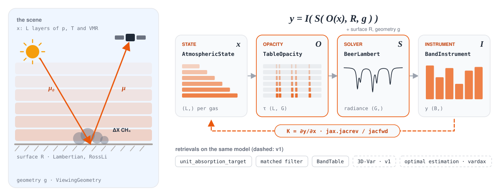
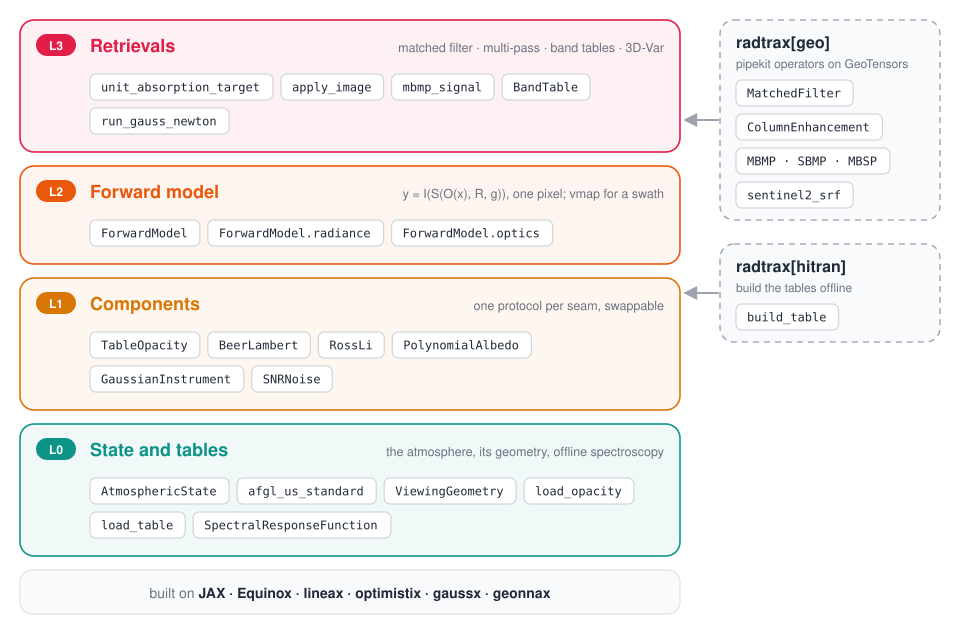
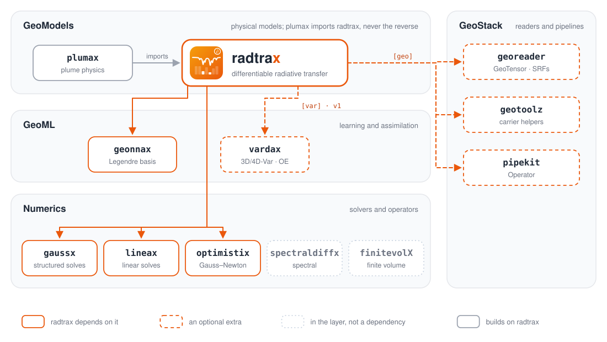

<p align="center">
  <picture>
    <source media="(prefers-color-scheme: dark)" srcset="docs/assets/logo-dark.svg">
    
  </picture>
</p>

<p align="center">
  <a href="https://github.com/jejjohnson/radtrax/actions/workflows/ci.yml"></a>
  <a href="https://github.com/jejjohnson/radtrax/actions/workflows/typecheck.yml"></a>
  <a href="https://codecov.io/gh/jejjohnson/radtrax"></a>
  
  <a href="https://opensource.org/licenses/MIT"></a>
</p>

<p align="center">
  <a href="https://jejjohnson.github.io/radtrax/"><b>Docs</b></a> ·
  <a href="https://jejjohnson.github.io/radtrax/reference/"><b>API</b></a> ·
  <a href="https://jejjohnson.github.io/radtrax/reference/capabilities/"><b>Capability index</b></a> ·
  <a href="https://jejjohnson.github.io/radtrax/v0-layers-vs-slab/"><b>Examples</b></a> ·
  <a href="https://github.com/jejjohnson/geostack/tree/main/docs/geomodels"><b>Design</b></a>
</p>

**Differentiable radiative transfer in JAX, for methane and multi-gas remote sensing.**

Write the forward model once, from an atmospheric state to what a sensor
measures, $y = F(x)$. Every Jacobian a retrieval needs,
$K = \partial F / \partial x$, then comes from automatic differentiation:
the matched-filter target, a multi-band multi-pass signal, a band table,
3D-Var and optimal estimation all use the same model and its derivatives.
No adjoint is written by hand. Formerly **rtmx**.

<p align="center">
  <picture>
    <source media="(prefers-color-scheme: dark)" srcset="docs/assets/forward-model-dark.svg">
    
  </picture>
</p>

## Quick start

```bash
uv add "radtrax @ git+https://github.com/jejjohnson/radtrax.git"
```

```python
import jax

jax.config.update("jax_enable_x64", True)  # float64 for spectroscopy

import equinox as eqx
import jax.numpy as jnp
import numpy as np
from jaxtyping import Array, Float

from radtrax import ForwardModel, unit_absorption_target
from radtrax.atmosphere import AtmosphericState, ViewingGeometry, afgl_us_standard
from radtrax.instrument import BandInstrument, SpectralResponseFunction
from radtrax.solvers import BeerLambert
from radtrax.spectroscopy import TableOpacity, load_opacity
from radtrax.surface import Lambertian

# Opacity O: per-layer τ from cached HITRAN tables (build them once with radtrax[hitran])
opacity: TableOpacity = load_opacity(["CH4", "H2O"])
nu: Float[Array, " G"] = opacity.nu_cm  # wavenumber grid (G,) [cm⁻¹]

# Instrument I: EMIT-like bands, 8.5 nm FWHM every 7.5 nm in the 2.3 µm window
wl_nm = 1e7 / np.asarray(nu)[::-1]  # (G,) ascending wavelength [nm]
centers_nm = np.arange(2300.0, 2350.0, 7.5)  # (B,)
srf = SpectralResponseFunction(
    wavelengths_hr_nm=wl_nm,
    band_centers_nm=centers_nm,
    band_widths_nm=np.full(centers_nm.size, 8.5),
    band_names=tuple(f"{c:.1f}" for c in centers_nm),
)

# y = I(S(O(x), R, g)): state → opacity → solver → instrument
model = ForwardModel(opacity, BeerLambert(), BandInstrument.from_srf(srf, nu))

atm: AtmosphericState = afgl_us_standard(z_top_km=20.0, gases=["CH4", "H2O"])  # L = 20
surface = Lambertian(0.25)
geometry = ViewingGeometry.from_angles(sza_deg=35.0, vza_deg=10.0)

y: Float[Array, " B"] = model(atm, surface, geometry)  # (B,) per unit solar irradiance

# Matched-filter target t = ∂ ln y / ∂ΔX [per mol/m²], by forward-mode autodiff
t: Float[Array, " B"] = unit_absorption_target(model, atm, surface, geometry)  # (B,)


# A swath of Jacobians: vmap over pixels, outside jacrev
def bands(theta: Float[Array, " 2"]) -> Float[Array, " B"]:
    """θ = (ΔX [mol/m²], albedo) → y."""
    return model(atm.add_column("CH4", theta[0]), Lambertian(theta[1]), geometry)


theta = jnp.stack([jnp.linspace(0.0, 0.1, 256), jnp.full(256, 0.25)], axis=1)  # (N, 2)
K: Float[Array, "N B 2"] = eqx.filter_jit(eqx.filter_vmap(jax.jacrev(bands)))(theta)
```

`load_opacity` reads tables from your cache. If one is missing, the error
names the command that builds it
(`python -m radtrax.spectroscopy.hitran CH4 H2O`, with the `[hitran]` extra).

## What is inside

<p align="center">
  <picture>
    <source media="(prefers-color-scheme: dark)" srcset="docs/assets/architecture-dark.svg">
    
  </picture>
</p>

Every layer uses only the ones beneath it, and every seam between components
is a protocol (`OpacityProvider`, `RTSolver`, `Surface`, `Instrument`,
`NoiseModel`), so you can swap one component without touching the others:

| Seam | Implementations today |
|---|---|
| Atmosphere | `AtmosphericState`, `afgl_us_standard`, `layers_from_levels`; `ViewingGeometry` with plane-parallel or spherical-shell (Chapman) air mass |
| Opacity | `TableOpacity`: per-layer τ (L, G), bilinear in (ln p, T) on HITRAN tables |
| Solver | `BeerLambert` |
| Surface | `Lambertian`, `PolynomialAlbedo` (Legendre in ν), `RossLi` (RossThick + LiSparse-Reciprocal) |
| Instrument | `BandInstrument` (any SRF matrix, shift on the grid), `GaussianInstrument` (analytic shift in cm⁻¹ or nm) |
| Noise | `DiagonalNoise`, `SNRNoise`, as lineax operators with `log_prob` through gaussx |
| Retrieval | the matched filter (backgrounds, clusters, streaming, a target from autodiff), the multi-pass family (`mbmp_signal`, `sbmp_signal`, `mbsp_signal`), `BandTable`, 3D-Var |
| `[geo]` | the same retrievals as pipekit operators on georeader `GeoTensor`s, with Sentinel-2 SRFs |

## Status

| Stage | What lands | State |
|---|---|---|
| Port | plumax's band-integrated Beer–Lambert models, HITRAN tables, matched filter and 3D-Var, ported with their tests | done |
| One of each | one matched filter, one SRF integration, one air-mass factor; GeoTensor operators behind `radtrax[geo]` | done |
| v0 | the layered forward model and matched-filter targets from autodiff | done; gate V2 against HITRAN runs in CI next ([#116](https://github.com/jejjohnson/radtrax/issues/116)) |
| v1 | spherical air mass, kernel BRDF, spectral albedo, analytic instrument, noise models, multi-pass family, band tables | on `main` |
| v1 | optimal estimation on vardax; sensors and real-scene gates on EMIT, Sentinel-2 and Landsat 8/9 | in progress: [Wave 4](https://github.com/jejjohnson/radtrax/issues/100) |

## Where it sits

<p align="center">
  <picture>
    <source media="(prefers-color-scheme: dark)" srcset="docs/assets/ecosystem-dark.svg">
    
  </picture>
</p>

radtrax is a GeoModels package, and every dependency points down a layer:
to Numerics (gaussx, lineax, optimistix), to GeoML (geonnax now, vardax for
v1's optimal estimation) and, through `[geo]`, to the GeoStack readers and
pipelines. It never imports plumax: plume physics uses radiative transfer,
not the other way round. The rules are in geostack's
[dependency graph](https://github.com/jejjohnson/geostack/tree/main/docs),
and `tests/test_dependency_rules.py` checks them here.

## Install

The base install is JAX-only: JAX, Equinox, jaxtyping, lineax, optimistix,
gaussx and geonnax, plus NumPy, xarray and scikit-learn for the matched
filter's backgrounds. The extras add the rest:

| Extra | Adds | For |
|---|---|---|
| `[hitran]` | HAPI | building the cross-section tables offline |
| `[geo]` | georeader, geotoolz, pipekit | operators on `GeoTensor`s, Sentinel-2 SRFs |
| `[bayes]` | reserved: NumPyro and optax as those retrievals land | Bayesian and L-BFGS retrievals |

## Develop

```bash
make install     # uv sync --all-groups + pre-commit hooks
make test        # tests + doctests (float64 on)
make lint typecheck
make docs        # MyST prose + MkDocs API reference into public/
```

The rules for contributors and coding agents are in [`AGENTS.md`](AGENTS.md);
code review follows [`CODE_REVIEW.md`](CODE_REVIEW.md). The figures are
generated: edit `docs/assets/make_assets.py` and run it.

## License

MIT.
